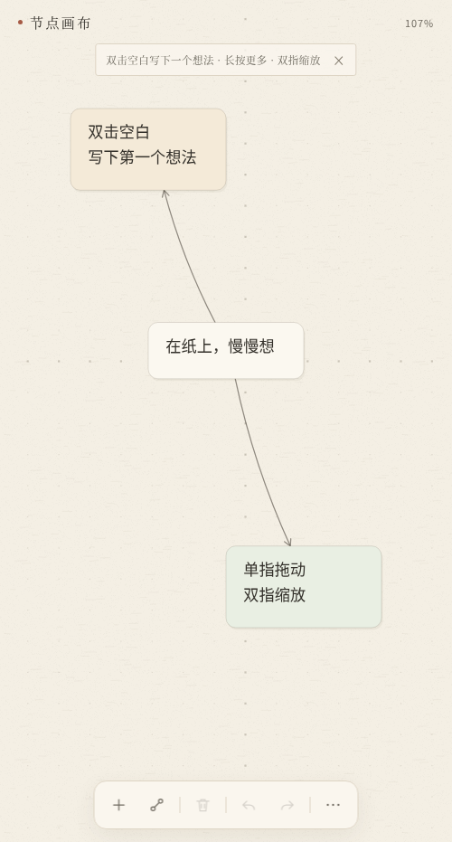

# 画布

> 纸上的一张关系草稿纸。

手机优先、单文件、零依赖的节点画布。双击空白写下想法，用细线连起关系；自动保存在本机，离线可用。

[在线预览](https://stuttefrfix.github.io/huabu-canvas/) · [下载 Android APK](https://github.com/STUTTEFRFIX/huabu-canvas/releases/latest) · [查看源码](https://github.com/STUTTEFRFIX/huabu-canvas) · [接手文档](HANDOVER.md)



## 特点

- **纸感极简**：暖骨白纸面、炭墨文字、发丝细线、极轻纸纹；标题用衬线，正文用无衬线。
- **手机优先**：单指拖动、双指缩放、长按菜单；双击空白直接建节点并弹出键盘。
- **本地优先**：自动保存到浏览器 localStorage，不登录、不联网、不上传。
- **多画布**：顶部切换、保存、新建；每张画布独立保存节点、连线和视野。
- **分组与挤压**：长按空白拖出选框多选，工具栏新建分组；分组自动包住内容，可嵌套、折叠、整组拖动。
- **单文件**：整个 Web 应用就是一个 `index.html`，没有构建步骤和依赖。
- **可安装**：`android/` 里是一个最小 WebView 壳，可编译成 APK。
- **可缩放**：1% 到 12800%，缩到再小也能看全局，放到再大也能读细节。

## 使用

### 浏览器

直接打开 `index.html`，或者起一个静态服务器：

```sh
python3 -m http.server 8000
```

然后访问 `http://localhost:8000/`。

### Android

从 [Releases](https://github.com/STUTTEFRFIX/huabu-canvas/releases/latest) 下载 `huabu-0.3.0.apk` 安装。

当前 APK 使用 debug 签名，可以直接安装和覆盖升级；如果要上架或长期分发，请用 `android/build.sh` 换成自己的 release keystore。

首次构建会在 `android/debug.keystore` 生成调试签名。请保留这个文件：删除后重新生成的密钥对不上，新 APK 将无法覆盖安装旧版本。

### 多画布

点击顶部的「画布 1」打开菜单：

- **切换画布**：点列表里的任意画布，节点、连线和视野都会恢复；
- **保存当前画布**：立即写入本地（平时也会自动保存）；
- **新建画布**：另起一张空白画布，自动命名为「画布 2」「画布 3」……

每张画布是独立文档，互不影响；切换前会自动保存当前画布。

### 分组（挤压关系）

分组是会自动包住内容的纸框，可以一层套一层。

- **框选**：长按空白后拖动，拉出选框，松开选中框内节点；
- **新建**：选中节点后点工具栏的虚线方框按钮，新建分组；
- **挤压**：分组自动包住子节点和子分组，拖动内容时外框实时收缩或扩张；
- **移动**：拖动分组标题整组移动；点分组空白选中分组；
- **管理**：长按分组标题折叠、展开、选上层、解散或删除；
- **归属**：把节点拖进另一个分组会自动换归属，拖出后回到上层；节点菜单里也有「移出分组」「选择所在分组」。

## 操作

| 操作 | 结果 |
| --- | --- |
| 顶部「画布 1」 | 切换画布、保存当前画布、新建画布 |
| 双击空白 | 在点击处新建节点，键盘弹出，直接输入 |
| 双击节点 | 编辑文字 |
| 单击 / 拖动节点 | 选中 / 移动 |
| 单击空白 | 取消选择（分组内则选中分组） |
| 单指拖动空白 | 平移画布 |
| 双指捏合 / 双指拖动 | 缩放 / 平移 |
| 长按空白后拖动 | 拉出框选，松开选中框内节点 |
| 长按空白不移动 | 新建节点、适应画布 |
| 双击分组内空白 | 在分组内新建节点 |
| 长按节点 | 编辑、连线、改颜色、移出分组、删除 |
| 长按分组标题 | 折叠/展开、选上层、解散或删除 |
| 拖动分组标题 | 整组移动 |
| 长按连线附近 | 删除这条连线 |
| 底部「+」 | 在屏幕中央新建节点 |
| 底部连线按钮 | 点两个节点完成连线 |
| 底部虚线方框 | 将选中节点新建分组 |
| 底部删除按钮 | 删除选中节点及其连线；选中分组时解散分组 |
| 撤销 / 重做 | 最多保留 100 步 |
| 「⋯」 | 适应画布、导出 / 复制 / 导入 JSON、清空 |
| 桌面右键 | 同长按菜单；滚轮缩放 |

编辑时按 Enter 换行，点键盘上方的「完成」或点画布空白提交。空文本提交会删除节点，撤销可找回。

## 数据

- 画布索引保存在 `node-canvas-index-v2`，每张画布的文档在 `node-canvas-doc-v2:<id>`。
- 分组和节点的 `parentId` 一起写入画布文档；旧画布没有分组字段时默认为空。
- 从 v0.1.x 升级时，旧的 `node-canvas-doc-v1` 会自动迁移为「画布 1」。
- APK 同样使用 WebView 的本地存储。
- 「导出 JSON」在 Web 版触发下载；在 APK 里保存到 `下载/画布/`。
- 「复制 JSON」在 APK 里直接写入系统剪贴板。
- 没有账号、没有云同步。

## 构建 APK

需要 JDK 17+、Android SDK（platform 36 与 build-tools）。

```sh
ANDROID_SDK=/path/to/android-sdk bash android/build.sh
```

输出：`android/build/huabu-0.3.0.apk`。

脚本会：

1. 把根目录的 `index.html` 复制到 `android/assets/`；
2. 用 `aapt2` 编译资源并链接 APK；
3. 用 `javac` 编译 Activity，`d8` 转成 dex；
4. 用 `zipalign`（可用时）对齐，`apksigner` 用 `android/debug.keystore`（首次自动生成）签名。

GitHub Actions 也会在每次 push 到 `main` 时构建 APK 并上传 artifact，见 `.github/workflows/android.yml`。

## 自测

Web 版地址后加 `?selftest=1` 打开，会清空本地数据并跑 26 项交互检查，结果显示在页面标题里：

```sh
chromium-headless --window-size=500,931 --virtual-time-budget=4000 \
  --dump-dom "file:///path/to/index.html?selftest=1" | grep -o '<title>.*</title>'
```

当前结果：**26 / 26 通过**。

覆盖项：初始画布、双击新建、写入文字、撤销、重做、拖动、连线、命中连线、删除连线、单指平移、双指缩放、最小缩放 1%、最大缩放 12800%、新建分组、嵌套分组、折叠隐藏、展开恢复、框选命中、拖动分组、节点拖入分组、解散保留内容、新建/切换画布、长按框选手势、写入 localStorage 与分组。

## 项目结构

```
.
├── index.html                 # 完整的 Web 应用（单文件）
├── preview.png                # 预览图
├── android/
│   ├── AndroidManifest.xml
│   ├── build.sh               # 无 Gradle 的手动构建脚本
│   ├── res/                   # 纸色主题、自适应图标
│   └── src/.../MainActivity.java
├── .github/workflows/android.yml
└── LICENSE
```

`android/assets/index.html` 与 `android/build/` 由构建脚本生成，已忽略。

## 设计

- 纸面：`#f4efe4`；纸片：`#fbf8f0`；墨色：`#34312b`；黛青：`#4d6670`；印记赭红：`#a65a45`。
- 节点是 1px 发丝边框的浅色纸片，下面只有一层极轻纸影。
- 连线是轻微弯曲的墨线，箭头是开放的两段细线，不是实心三角。
- 选中是 1.5px 黛青细框，没有发光。
- 纸纹由程序生成，固定在屏幕空间；点阵随画布移动。
- 正文 16px / 行高 26px；正文对比度约 11:1，次要文字约 4.7:1。

缩放范围故意放得很宽：缩到 1% 看整体结构，放到 12800% 看单字细节。缩到很小时箭头会隐藏，放大到超过 2.5 倍再编辑会自动回落到舒适倍率。

## 接手开发

想继续维护这个项目，先读 [接手文档](HANDOVER.md)：问题背景、实现过程、参考项目、代码地图、构建与发版流程。

## 灵感

交互与数据结构思路参考了 [Project Graph](https://github.com/graphif/project-graph)（GPL-3.0）。本项目是独立实现，未复制其源码。

## License

[MIT](LICENSE) © 2026 STUTTEFRFIX
